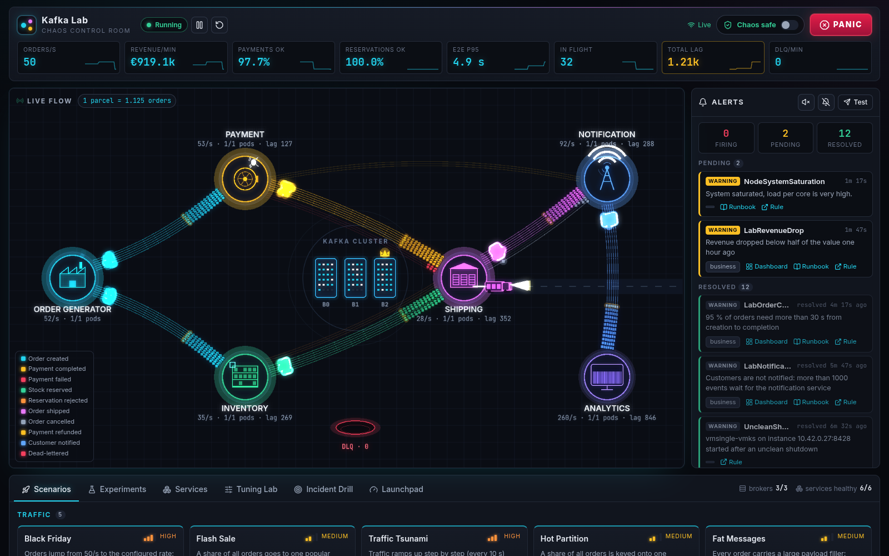
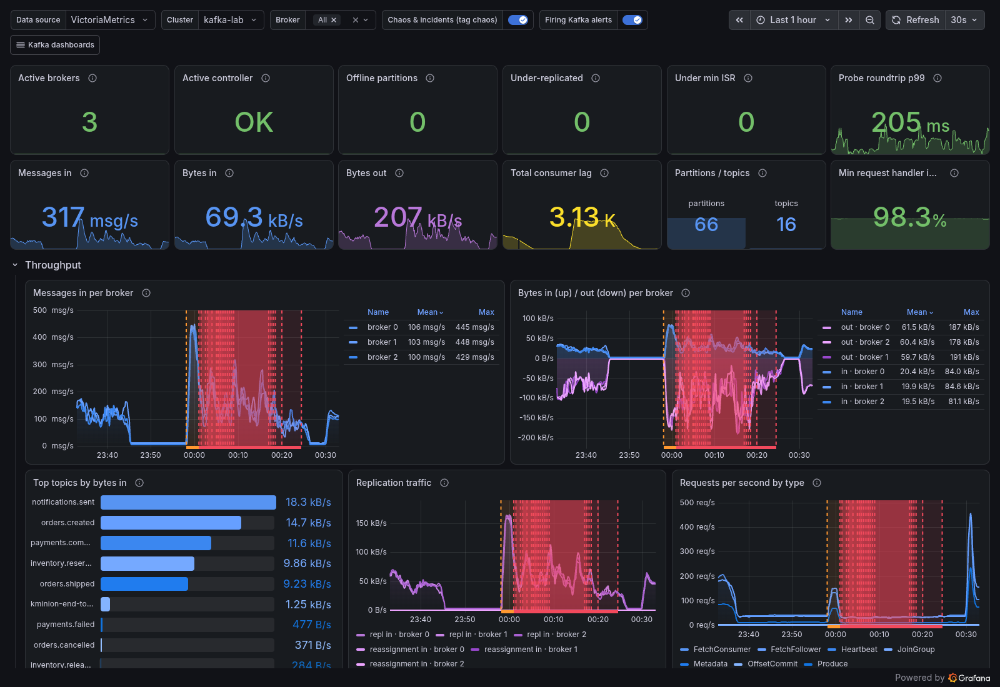
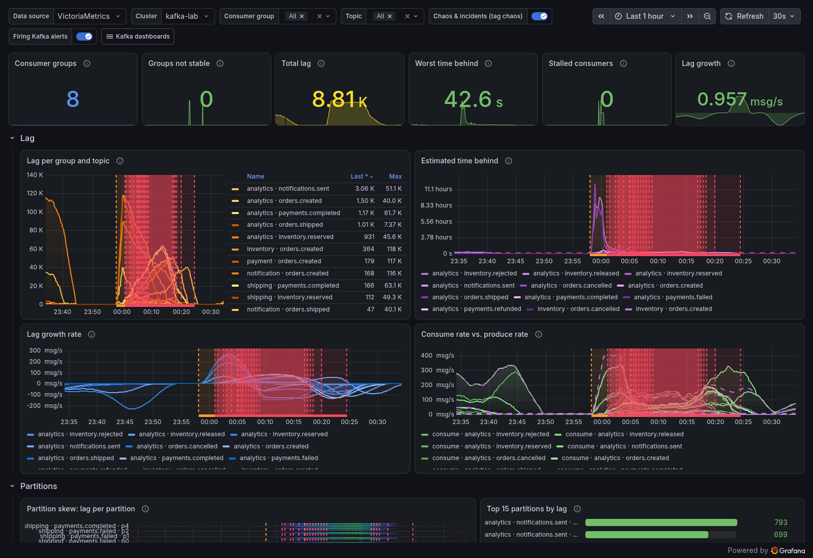
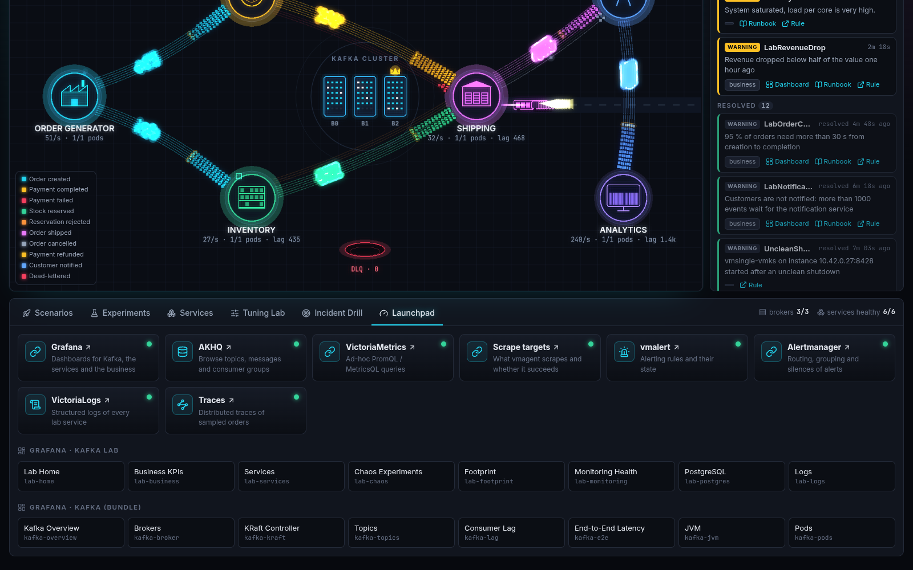

# Kafka Lab

A Kafka monitoring showcase you can play with: a commerce simulation (orders, payments, stock,
shipping, notifications) runs on a 3-node Kafka cluster (KRaft, Strimzi) in a local k3s
cluster (k3d). Everything is measured — system, Kafka, JVM, client and business metrics —
in VictoriaMetrics and shown in Grafana. A gamified **controlboard** lets you start traffic
spikes, outages and broker failures, watch orders fly and parcels pile up, and receive alerts.



| Kafka Cluster Overview (Grafana) | Consumer Groups & Lag (Grafana) |
|---|---|
|  |  |

The launchpad links every web UI and dashboard:



Screenshots are rendered from the running stack with `cd controlboard/web && bun run readme-shots`.

## Quick start

```bash
./start_stack.sh     # everything below in one step, then prints a short tutorial
make bootstrap      # pinned toolchain into .tools/ (Go, kubectl, helm, helmfile, k3d) — no sudo
make up             # k3d cluster + images + every Helm release (≈ 10 min the first time)
make status         # pods and URLs
./kctl get pods -A  # kubectl that always targets this cluster, from any directory
```

| UI | URL |
|---|---|
| Controlboard | http://board.localhost:8080 |
| Grafana (admin/admin, anonymous viewer) | http://grafana.localhost:8080 |
| AKHQ | http://akhq.localhost:8080 |
| VictoriaMetrics | http://vm.localhost:8080/vmui |
| vmagent targets | http://vmagent.localhost:8080/targets |
| vmalert | http://vmalert.localhost:8080 |
| Alertmanager | http://alertmanager.localhost:8080 |
| VictoriaLogs | http://logs.localhost:8080/select/vmui |

All ports are bound to `127.0.0.1` only. `make down` stops the cluster (data kept), `make nuke`
deletes it, `make reset` rebuilds from scratch. `PROFILE=lite make up` runs a single broker
without logs/traces (≈ 5 GB RAM).

## Architecture

```
order-generator ─► orders.created ─┬─► payment ──► payments.completed | payments.failed
                                   └─► inventory ► inventory.reserved | inventory.rejected
all four outcomes ─► shipping ─► orders.shipped | orders.cancelled
orders.cancelled ─► payment (payments.refunded), inventory (inventory.released)
outcomes ─► notification ─► notifications.sent        everything ─► analytics (business metrics)
controlboard ─► platform.control (desired knobs per service) · platform.audit
JMX exporter, KMinion, node-exporter, cAdvisor, kube-state-metrics, postgres_exporter, /metrics
   ─► vmagent ─► VictoriaMetrics ─► Grafana        vmalert ─► Alertmanager ─► controlboard
pod logs ─► VictoriaLogs        OTLP traces ─► VictoriaTraces
```

- **Services**: Go + franz-go, Avro (IDL in `schemas/*.avdl`) via Karapace, state in PostgreSQL,
  at-least-once with idempotent processing (`pkg/kit/runner`). Contracts: `docs/contracts/`.
- **Portable monitoring bundle**: `monitoring/bundle/` — JMX exporter config, KMinion values,
  dashboards, alert rules and runbooks that work on any Kafka cluster (Strimzi, plain
  Kubernetes, VMs). Read `docs/metrics-performance-impact.md` before enabling metrics on a
  production cluster.
- **Decisions**: `docs/adr/`.

## What to do first

Follow `docs/guided-tour.md` (Black Friday, Payment Provider Down, broker failure, …).

## Measured (default profile, 3 brokers, all extras)

| | |
|---|---|
| Memory (process memory inside the k3d node: pods + k3s) | ≈ 7.5 GB (budget 10 GB); pods alone 5.9–6.3 GB working set; Kafka 3.4 GB, monitoring 1.9 GB |
| Baseline traffic | 50 orders/s ≈ 400 events/s through 6 services |
| Quality gate `make ci` | Go 100 % statement coverage (race detector on), 235 frontend tests (99.9 % lines, 95.7 % branches), alert rule unit tests, dashboard lint |
| End-to-end `make e2e` | all web UIs reachable, all scrape targets up, 3 brokers / 1 controller, orders flow end to end, logs searchable, memory budget |

## Dashboards and alerts

- Bundle (folder *Kafka (bundle)*): Cluster Overview, Broker Deep Dive, KRaft Controller &
  Quorum, Topics/Partitions/Storage, Consumer Groups & Lag, End-to-End Probe, JVM, Pods & Nodes.
- Demo (folder *Kafka Lab*): Home, Commerce Business, Service & Client Runtime, Chaos
  Experiments, Stack Footprint, Monitoring Overhead, PostgreSQL, Logs.
- 24 Kafka alert rules (production and demo profiles) + 5 business rules, each with a runbook in
  `docs/runbooks/`, routed through Alertmanager into the controlboard's alert panel.

## Development

```bash
make help      # all targets
make ci        # lint + tests + coverage gates (what GitHub Actions runs)
make gen       # regenerate Avro schemas and Go types from schemas/*.avdl
make images    # build + push service images to the k3d registry
make deploy    # helmfile sync of all releases
```

Conventions (test naming, GIVEN/WHEN/THEN, coverage rules) are in `CLAUDE.md`;
coverage exceptions with reasons in `docs/coverage-exceptions.md`.

## License

Code is licensed under the [Apache License, Version 2.0](LICENSE).
Documentation in `docs/` is licensed under [CC BY 4.0](docs/LICENSE).
Copyright 2026 allwerker eG, see [NOTICE](NOTICE).
